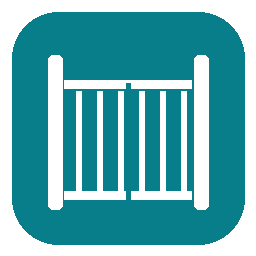

# Brivo Mobile Pass for Home Assistant

[](https://github.com/ColeMundus/ha-brivo-mobile-pass/actions/workflows/validate.yml)
[](https://my.home-assistant.io/redirect/hacs_repository/?owner=ColeMundus&repository=ha-brivo-mobile-pass&category=integration)
[](https://github.com/ColeMundus/ha-brivo-mobile-pass/blob/main/custom_components/brivo_mobile_pass/manifest.json)
[](https://github.com/ColeMundus/ha-brivo-mobile-pass/releases/latest)
[](LICENSE)

Open Brivo Mobile Pass gates and doors from Home Assistant. The integration adds an **Open** button for each enabled access point on your pass.

Requires Home Assistant 2026.10 or later, internet access, and a valid Brivo Mobile Pass.

## Install

### HACS

Use [Open in HACS](https://my.home-assistant.io/redirect/hacs_repository/?owner=ColeMundus&repository=ha-brivo-mobile-pass&category=integration), or add it manually:

1. In HACS, open **Custom repositories**.
2. Add `https://github.com/ColeMundus/ha-brivo-mobile-pass` with the category **Integration**.
3. Download **Brivo Mobile Pass** and restart Home Assistant.
4. Open **Settings → Devices & services → Add integration** and select **Brivo Mobile Pass**.

### Manual installation

Copy `custom_components/brivo_mobile_pass` into Home Assistant's `custom_components` directory, restart Home Assistant, and add the integration through **Devices & services**.

## Set up

Setup needs two types of credentials:

1. **Brivo app credentials:** the OAuth client ID and client secret used by the Mobile Pass application. These identify the app and do not grant access to your gates or doors on their own.
2. **Your pass authorization:** either an existing Mobile Pass refresh token, or an unused invitation code and the email address it was sent to. This authorizes access through your pass.

The app credentials must match the application that issued your refresh token. You do not need to register an OAuth application for this integration. Use the [APK extraction helper](docs/APP_CREDENTIALS.md) to find the app credentials in a downloaded APK.

Enter both types in the setup form. Invitation codes can only be used once. If setup fails after activation, submit the same details to continue with the saved credentials.

Home Assistant saves the credentials and refreshes access tokens automatically. Protect your Home Assistant configuration and backups, which contain these credentials.

## Use

Press an access point's **Open** button to send an unlock request. You can add these buttons to a dashboard or use them in scripts and automations.

```yaml
actions:
  - action: button.press
    target:
      entity_id: button.example_gate_open
```

Replace `button.example_gate_open` with the entity ID shown in Home Assistant.

Buttons send commands; they do not report whether a gate is physically open or closed. Disable any buttons you don't want through Home Assistant's entity settings.

To check the connection without opening a gate, run `brivo_mobile_pass.check_connection`. If you have multiple passes, select the integration in the action's **Integration** field.

## Troubleshooting

- **Expired or revoked pass:** Follow Home Assistant's reauthentication prompt with a valid refresh token or new invitation.
- **HTTP 403:** Check that your pass allows remote activation. Brivo may require proximity or other checks for that access point.
- **Connection failure:** Check your internet connection. Before retrying, check whether the gate opened; Brivo may have received the first request.
- **Missing gate or door:** Reauthenticate to discover changes to your pass's access points.
- **Credentials could not be saved:** Check Home Assistant's disk space and storage permissions.

## Contributing

See [development and API details](docs/ARCHITECTURE.md) and [release instructions](docs/PUBLISHING.md). Report bugs through [GitHub Issues](https://github.com/ColeMundus/ha-brivo-mobile-pass/issues). Keep credentials out of reports; see [SECURITY.md](SECURITY.md).
